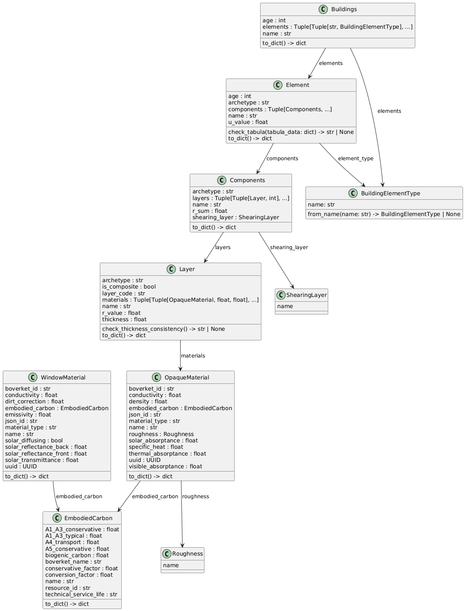

# Energy Database – Working Repository

This repository contains the working structure for the EPSM energy and material database. It includes class definitions, material extraction scripts, and generated JSON files as well as a database used for energy and embodied carbon calculations.

Any class specific checks should be defined within the class however anything cross-field is done externally in the instance loader. 

---

## Class Structure

Class structure  is detailed in the image below. By utilising this structure

## Repository Structure

Currently any script is in the **NewSchema** folder. It contains instance, database and graph generation. All .json files are exported to the **output** folder. Data used, such as the Material_Database.xlsx, opaque_material.json & window_material.json are located in **Data**

Graph and database files are currently in **EPSM_DATA** 

## Scripts

### Classes.py 

Contains all class defintions and supporting types. All core classes are immutable (frozen=True dataclasses), ensuring data integrity once instantiated. Validation logic lives in **__post_init__** methods, with softer warnings (e.g. thickness consistency, etc...). Any warning pertaining to the class is handled within, cross field warnings do not belong here.

### DataFetcher.py

Handles communication with the **Boverket Klimatdatabas API**.

- `fetch_all_materials()` — fetches the full resource list from the API, filtering for valid material entries with a `ResourceId`.
- `parse_material_api()` — maps a raw API response for a single material into an `EmbodiedCarbon` instance

### InstanceLoader.py

Reads and assembles the full building model hierarchy from `Material_Database.xlsx` and supporting data sources, building up from materials to complete buildings.

Each loader follows the same pattern: parse rows, validate fields, skip and report invalid entries, then return a list of clean instances.

- `load_opaque_materials()` — cross-references the Excel sheet with the Boverket API and a local EnergyPlus JSON file to construct `OpaqueMaterial` instances.
- `load_layers()` — assembles `Layer` instances from material references, resolving missing area fractions automatically and flagging thickness inconsistencies as soft warnings.
- `load_components()` — groups rows by component code, sorts layers by index, and resolves shearing layer assignments.
- `load_elements()` — infers element type and construction age from component naming conventions, sorts components by shearing layer order, and runs TABULA U-value validation.
- `load_buildings()` — groups elements by archetype to form `Buildings`, using the earliest age found across its elements.

Helper functions `resolve_fractions()` and `parse_age_from_archetype()` handle fraction gap-filling and age extraction from archetype strings respectively.

Any cross-field validation can be added here. 

### Exporter.py

Serializes the fully loaded model hierarchy to dated JSON files in the `output/` directory.

`export_all()` takes lists of all model types and writes one JSON file per level (`materials`, `layers`, `components`, `elements`, `buildings`), each keyed by their primary identifier and dated `DD-MM-YYYY`.

### DB.py

Defines the SQLAlchemy ORM schema and initialises the SQLite database. Each class mirrors its counterpart in `Classes.py`, with many-to-many relationships handled through the junction tables.

- `DBEmbodiedCarbon` → `DBOpaqueMaterial` — one-to-many
- `DBLayer` ↔ `DBOpaqueMaterial` — via `DBLayerMaterial` (stores area fraction and thickness per material)
- `DBComponent` ↔ `DBLayer` — via `DBComponentLayer` (preserves layer index/order)
- `DBElement` ↔ `DBComponent` — via `DBElementComponent`
- `DBBuilding` ↔ `DBElement` — via `DBBuildingElement` (stores element type alongside the reference)

`init_db()` creates the engine and runs `create_all()` to initialise the schema, defaulting to `epsm.db`.

### DBExporter.py

Persists the fully loaded model hierarchy to the SQLite database defined in `DB.py`.

`export_to_db()` opens a single session and writes all records in hierarchy order, using `merge()` for primary-keyed tables (upsert behaviour) and `add()` for junction tables. Junction tables are cleared at the start of each export to avoid stale relationship rows. `EmbodiedCarbon` records are deduplicated by `resource_id` before insertion since multiple materials may share the same EPD entry.

### Graph.py

Builds and visualises the full model hierarchy as a directed graph using NetworkX, with export options for interactive HTML and Gephi.

- `build_graph()` — constructs a `DiGraph` traversing the full hierarchy from `Building` down to `EmbodiedCarbon`, storing instance attributes as node metadata and relationship type as edge metadata.
- `print_graph_summary()` — prints node and edge counts broken down by type.
- `visualise_pyvis()` — renders an interactive HTML graph via PyVis, with nodes colour- and size-coded by type.
- `export_gephi()` — writes a `.gexf` file for use in Gephi, stripping non-serialisable instance references beforehand.

When run directly, loads the full model pipeline and outputs both `graph.html` and `graph.gexf`.

### EnergyPlusConverter.py

Rewrites `opaque_material.json` to match the naming convention used in `Material_Database.xlsx`.
The output is utilised in grasshopper.

### main.py

Is the entrypoint. By running this script instances, .json files, and database are created. 

# Sources

The `Layers` class, located in classes.py calculates R-values using:

- The Lambda (λ) method  
- The U-value method  

These methods are based on:

- Persson, B. P.-Å. (2018). *Tillämpad byggnadsfysik*. Studentlitteratur. Sections 8.1 & 9.2.3.  
- Chalmers lecture material https://chalmers.instructure.com/courses/9012/files/345841?module_item_id=57479 

Tabula values in classes.py are sourced in: 

TABULA Building Typology Webtool  
https://webtool.building-typology.eu/#bm  

(Charts 1 data)
