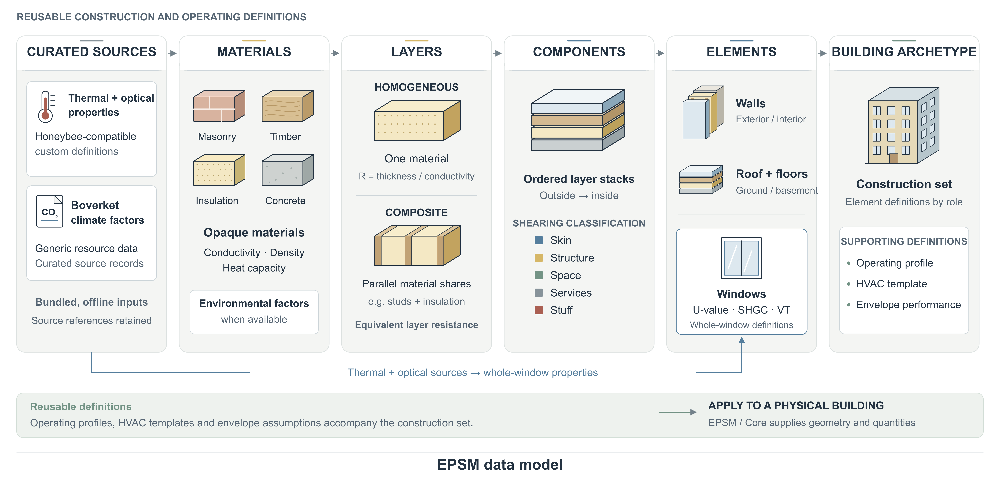

# EPSM Data

<!-- EPSM introduction: Pocket CAD -->
<picture>
  <source media="(prefers-color-scheme: dark)" srcset="docs/assets/welcome/epsm_data-dark.png">
  
</picture>

Meet the materials and constructions behind an EPSM building. EPSM Data helps
you find, inspect and author reusable materials, layered constructions,
archetypes, operating profiles and renovation measures. Explore the catalogue
offline, without Core, a database or a simulation engine.

**[Explore the EPSM platform →](https://github.com/SB-Chalmers/epsm/blob/main/docs/platform.md)**
<!-- /EPSM introduction -->

[](https://github.com/SB-Chalmers/epsm_data/actions/workflows/ci.yml) [](https://github.com/SB-Chalmers/epsm_data/releases) [](https://github.com/SB-Chalmers/epsm_data/issues)

## From materials to a construction set



Follow the reusable definitions from a sourced material to a construction set.
Core supplies the actual building geometry and quantities. The
[platform guide](https://github.com/SB-Chalmers/epsm/blob/main/docs/platform.md)
shows how these definitions feed energy and climate calculations.

## Getting started

Use Python 3.11 or newer. From a terminal on macOS or Linux:

```sh
git clone https://github.com/SB-Chalmers/epsm_data.git
cd epsm_data
python3 -m venv .venv
source .venv/bin/activate
python -m pip install --upgrade pip
python -m pip install -e .
python examples/archetype.py
```

The example authors and serializes an illustrative construction entirely offline.
To select a bundled archetype:

```python
from epsm_data import Catalogue

catalogue = Catalogue.load()
archetype = catalogue.for_year("multi_family", 1970)
construction = archetype.construction_set
```

Catalogue records retain their sources and assumptions. Core assigns definitions
to building geometry; EPSM owns catalogue-to-building application.

## Documentation

- [Catalogue inspection and reuse](docs/catalogue-inspection.md)
- [Archetype authoring and exchange](docs/archetype-authoring.md)
- [Operating profiles](docs/operating-profiles.md)
- [Examples and notebooks](examples/README.md)
- [Project guide and development](docs/guide.md)

## License

EPSM-owned software and documentation use the [MIT license](LICENSE).
Source datasets, catalogue evidence and third-party material retain their
providers' terms and attribution; MIT does not grant new redistribution rights
to those sources.

## People and support

Developed at Chalmers University of Technology as part of the EPSM research platform.

**Funding**: Swedish Energy Agency (Project ID: P2024-04053)

**Partners**:

- Lindholmen Science Park AB
- Sinom AB
- Stiftelsen Chalmers Industriteknik

**Team**:

- **Lead Developer**: Sanjay Somanath
- **Principal Investigator**: Alexander Hollberg
- **Contributors**: Yinan Yu, Dag Wästberg

<p align="center">
  
</p>
