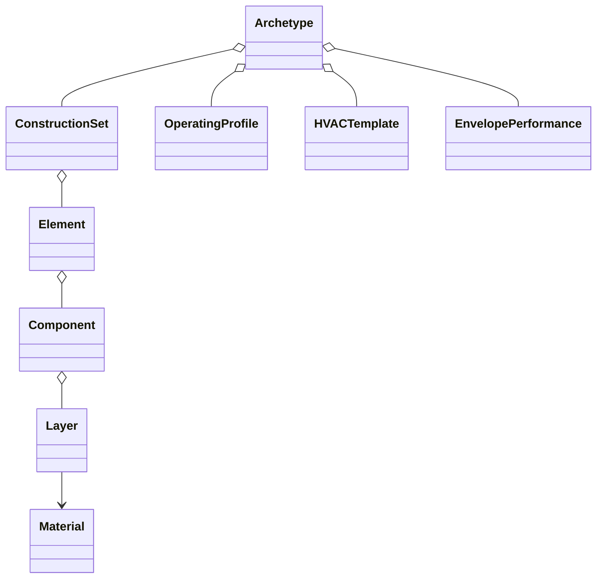

# Custom archetype authoring

Catalogue entries and custom definitions share the same immutable hierarchy:



`Archetype` and `BuildingArchetype` name the same class. Only an ID and display
name are required; a construction year, geometry or real building record is
optional. Add definitions as they become useful:

```python
from epsm_data import Archetype, EnvelopePerformance, OperatingProfile

archetype = Archetype("study:school", "Representative school")
authored = archetype.with_changes(
    building_typology="school",
    operating_profile=OperatingProfile(
        "study:use",
        {"building_assumptions": {"use": {"occupant_density_per_m2": 0.04}}},
    ),
    envelope_performance=EnvelopePerformance(
        infiltration_ach=0.2,
        infiltration_reference_basis="conditioned_volume",
    ),
)
assert archetype.operating_profile is None
print(authored.missing_sections)
```

Constructors and `with_changes()` validate supplied values. Replacements share
immutable definitions safely; editing one archetype cannot mutate its siblings.
`missing_sections` lists absent sections, while `summary()` describes supplied
inputs. A partial definition is valid for authoring.

For full construction recipes, use `build_archetype(spec, materials=...)` or the
material, layer, component, element and construction-set constructors. Opaque
recipes retain explicit thicknesses, area fractions and physical order.
[Construction composition](catalogue-composition.md) explains the conventions.
The [authoring notebook](../examples/02_author_archetype.ipynb) gives a complete
example. `with_renovation()` appends an already resolved intervention and its
replacement construction set.

## Envelope inputs

`EnvelopePerformance` accepts one infiltration rate with an explicit reference
basis. See [airflow units](airflow-inputs.md) for the supported fields and
conversions. `thermal_bridge_uplift_fraction` is a finite nonnegative fraction of
nominal transmission; Core applies it to physical constructions.
`thermal_bridge_delta_u_w_m2k` is the alternative absolute form, TABULA's
`delta_U_ThermalBridging`: an additive U in W/(m² K) on the whole envelope area
(opaque elements and glazing counted once), carried by the above-grade walls and
thermal top rather than by ground assemblies. Supply at most one of the two.
The catalogue gives offices the TABULA surcharge; housing and schools leave both
unknown, because the cohort validation rejected a surcharge for them. Store
source references and assumptions alongside these inputs.

## Portable exchange

```python
import json
from epsm_data import archetype_from_dict, archetype_to_dict

record = archetype_to_dict(authored)
restored = archetype_from_dict(json.loads(json.dumps(record)))
assert restored == authored
```

The self-contained record preserves physical composition, material UUIDs, ordered
layers and fractions, optional operating/system/envelope definitions, sources and
unknown sections. It restores offline without catalogue lookups. `summary()` and
the individual objects' `to_dict()` views are inspection summaries; use the
exchange functions for complete archetype round trips.
