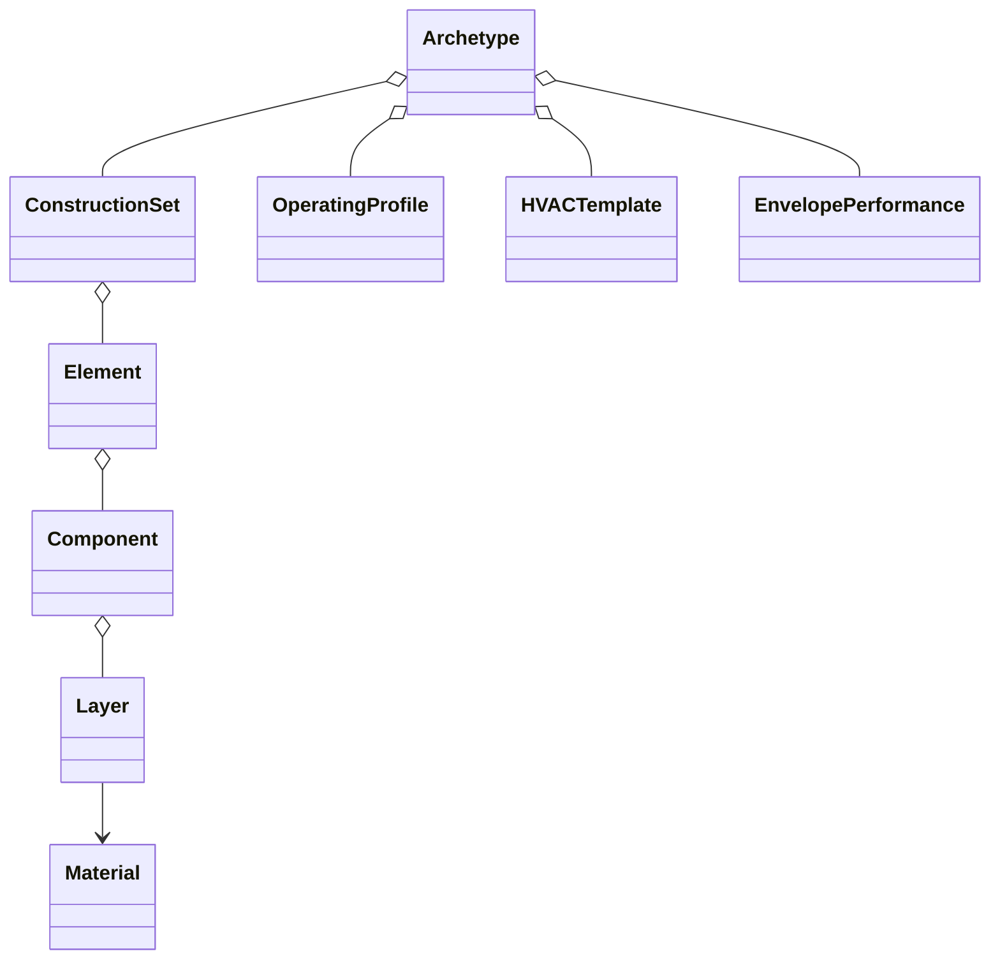

# Authoring a composed archetype

`Archetype` and `BuildingArchetype` are the same public class. Catalogue entries
and custom definitions share the physical hierarchy:



The composition follows Djamila's original EPSM Data materials-to-building class
diagram, extended with reusable operating, system and envelope definitions.
Data owns these definitions; Core owns geometry, physical validation and schedule
expansion; EPSM owns their application to a Building. This change implements Data
authoring and exchange. The coordinated Building-application API is a separate
implementation step.

## Start incomplete and add known definitions

```python
from epsm_data import Archetype, EnvelopePerformance, OperatingProfile

archetype = Archetype("project:test", "Research building")
assert archetype.construction_year is None
assert "construction_set" in archetype.missing_sections
profile = OperatingProfile(
    "project:partial-use",
    {"building_assumptions": {"use": {"occupant_density_per_m2": 0.04}}},
    source_references=("project:declared-assumptions",),
)
authored = archetype.with_changes(
    building_typology="research:custom",
    operating_profile=profile,
    envelope_performance=EnvelopePerformance(
        infiltration_ach=0.2,
        infiltration_reference_basis="conditioned_volume",
        notes=("Illustrative assumption; replace with project evidence.",),
    ),
)
assert archetype.operating_profile is None
```

Only `archetype_id` and `display_name` are required. Construction year may remain
unknown and classifications may use caller-owned vocabulary. Supply a
`ConstructionSet`, `OperatingProfile`, `HVACTemplate` or `EnvelopePerformance`
when known. An empty construction set is valid incomplete authoring.
`missing_sections` reports absent definition sections, not simulation readiness.
A present partial operating profile can still require many Core inputs.
`summary()` shows loaded definitions, sources, notes and missing sections without
I/O. Representations remain concise, including for partial definitions.

Constructors and `with_changes` validate supplied values without lookup.
`with_changes` returns a new definition; nested mappings and ordered collections
are frozen so sibling archetypes cannot be modified through shared state.
`with_renovation` retains composed sections when appending a supplied event.
Existing constructor positional order remains supported.

The [authoring notebook](../examples/02_author_archetype.ipynb) builds a material,
layer, component, element and construction set directly. `build_archetype` also
supports explicit recipes with no year or standard classification. Materials
and physical order remain the same objects used by catalogue constructions.

## Envelope rates retain their reference basis

Supply at most one infiltration rate:

| Rate | Unit | Required basis |
| --- | --- | --- |
| `infiltration_ach` | air changes per hour | `conditioned_volume` or `tabula_reference_volume` |
| `infiltration_l_s_m2` | litres per second per square metre | `Atemp` or `conditioned_floor_area` |

A TABULA source-volume rate requires the appropriate source volume and reference
area at application; Data never interprets it as model-volume ACH. Zero is a
known zero, and `None` remains unknown. Rates and
`thermal_bridge_uplift_fraction` must be finite and nonnegative. The uplift is
relative to nominal transmission; physical application belongs to Core.
Envelope definitions include source references and notes. They contain no site
ground conditions, weather, geometry or installed ventilation topology.

## Complete exchange uses format version 4

```python
import json
from epsm_data import archetype_from_dict, archetype_to_dict

record = archetype_to_dict(authored)
assert record["format_version"] == 4
restored = archetype_from_dict(json.loads(json.dumps(record)))
assert restored == authored
```

Version 4 includes complete physical composition, material UUIDs, ordered layers,
fractions, source records, optional profiles/templates/envelope assumptions,
notes and unresolved sections. Restore it offline with no catalogue or Core.
Readers continue to accept versions 1–3; missing new sections remain absent,
without invented defaults. Old software that only reads versions 1–3 must be
updated to read new version-4 output. Package versions and format versions are
separate. Existing summary dictionaries remain summaries, not lossless exchange.
