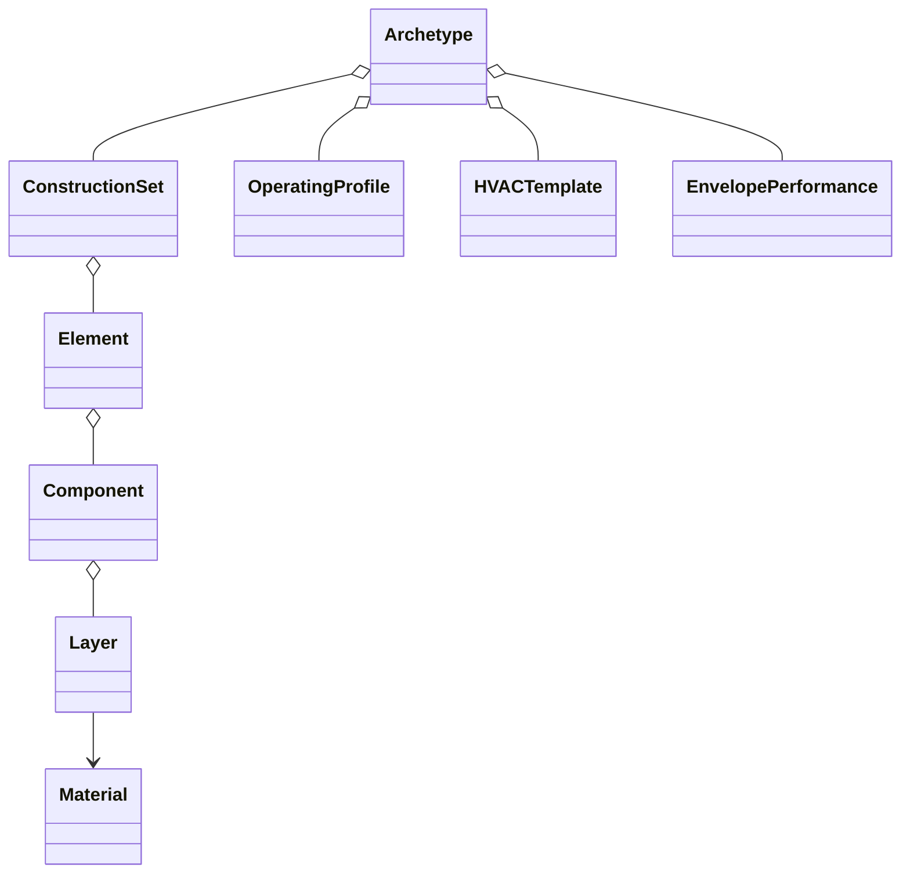

# Author and edit archetypes

You can write your own archetype with the same classes the catalogue uses. A
custom archetype and a catalogue selection behave the same way.



The classes are in `epsm_data/domain/` and all import from `epsm_data`.
`Archetype` and `BuildingArchetype` are the same class.

## Start small, add what you need

Only an ID and a display name are required. A construction year, geometry or a
real building record is optional.

```python
from epsm_data import Archetype, EnvelopePerformance, OperatingProfile

archetype = Archetype("study:school", "Representative school")
authored = archetype.with_changes(
    building_typology="school",
    operating_profile=OperatingProfile(
        "study:use",
        {"building_assumptions": {"use": {"occupant_density_per_m2": 0.04}}},
    ),
    envelope_performance=EnvelopePerformance(
        infiltration_ach=0.2,
        infiltration_reference_basis="conditioned_volume",
    ),
)
assert archetype.operating_profile is None
print(authored.missing_sections)
```

Every object is immutable. `with_changes()` returns a validated copy, so editing
one archetype never changes another that shares its parts. `missing_sections`
lists the sections still absent; `summary()` describes what is present. A partial
archetype is valid while you author it.

## Write constructions

Build constructions from `Material`, `Layer`, `Component`, `Element`,
`WindowElement` and `ConstructionSet`, or pass a whole recipe to
`build_archetype(spec, materials=...)` (in `catalogue/authoring.py`). Give each
layer its thickness in metres, its area fractions and its physical order. The
layer-order rules are in [the catalogue page](catalogue.md#layer-order-and-boundaries).

To record a renovation, `with_renovation(event, new_construction_set)` returns a
new archetype with a `RenovationEvent` and its resulting construction set. It does
not apply the measure; you supply the result. `RenovationMeasure`,
`ConstructionOperation` and `SystemOperation` (in `epsm_data/renovation/`)
describe measures for Core to apply.

## Envelope inputs

`EnvelopePerformance` holds infiltration and thermal-bridge inputs.

Infiltration is one rate with a stated reference basis:

| Field | Unit | Allowed basis |
| --- | --- | --- |
| `infiltration_l_s_m2` | L/(s m²) | `Atemp` or `conditioned_floor_area` |
| `infiltration_ach` | air changes per hour | `conditioned_volume` or `tabula_reference_volume` |

The consuming application converts a rate to its own building explicitly, using
that building's area or volume. A rate on a TABULA reference volume keeps that
basis; it must not silently become a model-volume air change rate.

Thermal bridges take one of two forms; supply at most one:

- `thermal_bridge_uplift_fraction`: a fraction (≥ 0) added to the nominal
  transmission. Core applies it to the constructions.
- `thermal_bridge_delta_u_w_m2k`: TABULA's `delta_U_ThermalBridging`, an added U
  in W/(m² K) over the whole envelope area (opaque elements and glazing counted
  once). It is carried by the above-grade walls and the thermal top, not by the
  ground assemblies.

The catalogue gives offices the TABULA surcharge. Housing and schools leave both
unknown, because the [measured-data validation](validation.md) did not accept a
surcharge for them.

In every input, `None` means unknown and `0` means a known zero.

## Save and restore

```python
import json
from epsm_data import archetype_from_dict, archetype_to_dict

record = archetype_to_dict(authored)
restored = archetype_from_dict(json.loads(json.dumps(record)))
assert restored == authored
```

The record is self-contained: materials and their UUIDs, ordered layers and
fractions, the operating, system and envelope sections, sources, and the list of
unknown sections. It restores offline without the catalogue.
`construction_set_to_dict` and `construction_set_from_dict` do the same for one
construction set. `summary()` and each object's `to_dict()` are for inspection
only; use the exchange functions for a full round trip. The code is in
`catalogue/serialization.py`.

## Draw sections

`plot_sections(archetype)` and `plot_section_comparison(...)` in
`epsm_data.plotting` draw construction cross-sections. They need the optional
`visualization` extra: `pip install -e '.[visualization]'`.

## Apply an archetype to a building

EPSM Data supplies constructions, operating profiles and system templates. A
simulation also needs:

- geometry, and from it which construction roles occur;
- the heated area (Atemp) and volume;
- weather and ground conditions;
- a calendar for office and school schedules;
- the installed systems, or the [ventilation template](profiles.md#ventilation-templates).

Sveby intensities use Atemp. Infiltration keeps its stated basis. The consuming
engine validates the full scenario. Save the resolved constructions, operating
inputs, areas, factors and ground settings with the results, so a later
catalogue change does not reinterpret a finished run.

| Package | Owns |
| --- | --- |
| `epsm_data` | Constructions, source records, operating profiles, renovation definitions |
| `epsm_core` | Geometry, buildings, quantities and engine inputs |
| `epsm` | Applying definitions and scenario assumptions to a building |
| `epsm_lca` | Life-cycle assessment with declared factors |
| `epsm_db` | Building stock records and their archetype assignments |
| `epsm_studio` | The authoring interface and project storage |
| `epsm_studies` | Study inputs, runs and results |

The [authoring notebook](../examples/03_author_and_edit.ipynb) builds a complete
archetype, and the
[renovation notebook](../examples/04_renovation_states_and_sections.ipynb)
compares states and draws sections.
